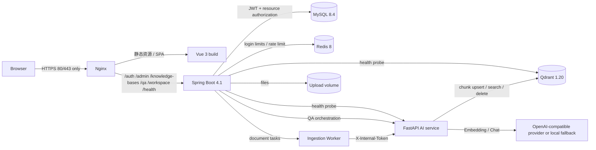
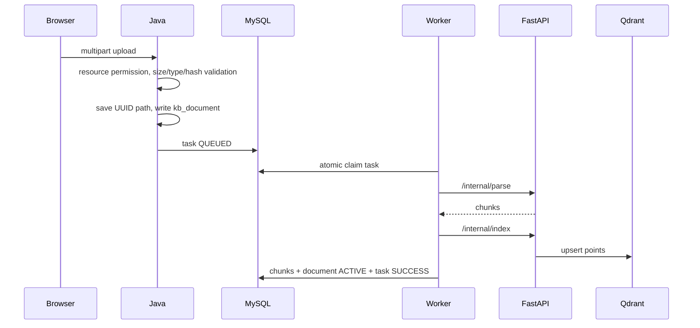
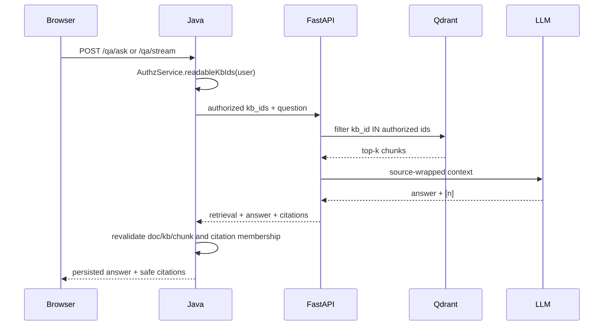

# 系统架构

> 任务：T5.9
> 对应实现：Vue 3 前端、Spring Boot 4.1 业务后端、FastAPI AI 服务、MySQL 8.4、Redis 8、Qdrant 1.20、Nginx。

## 1. 总体架构

架构边界是刻意固定的：

- Java 是用户、角色、知识库、文档、会话、引用和审计的唯一权威源。
- Python 不解析 JWT、不查用户表、不做权限判断，只处理 Java 已授权的 `kb_ids`。
- Nginx 不代理 `/internal/**`，内部 AI 接口只在 Docker 内网可见。
- MySQL、Redis、Qdrant、Java、Python 在宿主机均不映射端口。

## 2. 服务职责

| 服务 | 职责 | 持久化 |
|---|---|---|
| Nginx | TLS 终止、前端静态文件、SPA 回退、API 反向代理、SSE 透传 | 无 |
| Frontend | 登录、工作台、知识库/成员、文档、问答、系统设置 | 浏览器 localStorage 仅保存 JWT |
| Java | 认证授权、业务事务、任务队列、引用二次鉴权、审计、健康聚合 | MySQL、Redis、上传卷 |
| Python | 文档解析、切分、Embedding、Qdrant 读写、RAG 上下文、Chat/SSE | Qdrant、不持久化 API Key |
| MySQL | 17 张业务表、状态机、权限与审计 | named volume |
| Redis | 登录失败计数、问答限流 | named volume |
| Qdrant | 文档分片向量 points、payload 过滤 | named volume + snapshot |

## 3. 关键数据流

### 3.1 上传与索引

任务认领使用条件 `UPDATE` 和 `SKIP LOCKED`，多 Java 实例只会有一个成功。文档状态在
处理前、写分片前和回写成功前都会再次检查，删除竞态优先中止。

### 3.2 问答与引用

无命中时不伪造企业内部事实；系统先明确提示知识库无依据，再按配置进行通用知识回答，
且引用为空。打开历史引用、下载文件和分片原文都会再次执行服务端权限校验。

## 4. 部署视图

`deploy/compose.prod.yml` 只向宿主暴露：

| 宿主端口 | 服务 |
|---:|---|
| 80 | Nginx，301 到 HTTPS |
| 443 | Nginx TLS |

Docker 网络：

- `edge`：Nginx 与 Java。
- `data`（`internal: true`）：MySQL、Redis、Qdrant、Java、Python 的内部通信。
- `egress`：仅 Python AI 服务接入，用于访问外部 OpenAI-compatible 模型；其它内部服务
  没有公网出口。

上传文件使用独立 `knowbase-uploads` volume。Qdrant 的 storage 与 snapshots 分卷，便于单独
创建和恢复快照。

## 5. 开发与交付模式

| 模式 | 用途 | 入口 |
|---|---|---|
| dev | 本机热重载，基础设施容器化 | [README](../README.md) 快速开始 |
| prod/demo | 全部容器化，单机 Nginx 入口 | [RUNBOOK](RUNBOOK.md) |
| integration | Testcontainers + Testcontainers Python image | `mvn -Pintegration verify` |

架构图、Compose、Nginx 和 RUNBOOK 的端口、服务名和依赖方向必须同步修改。任何新增
宿主机端口映射或公网内部接口都属于安全边界变更。

## 6. 扩展路径

当前是模块化单体 + 独立 AI 服务。若未来需要横向扩展：

1. Java 保持无状态，任务认领已支持多实例。
2. 上传文件改为 S3/MinIO，避免共享本地卷。
3. Redis/Qdrant/MySQL 使用托管服务并启用网络 TLS。
4. AI 服务按解析、Embedding、Chat 拆分时仍只接受已授权 `kb_ids`。
5. 在入口层增加 WAF 和真实证书；不要直接暴露内部服务。
