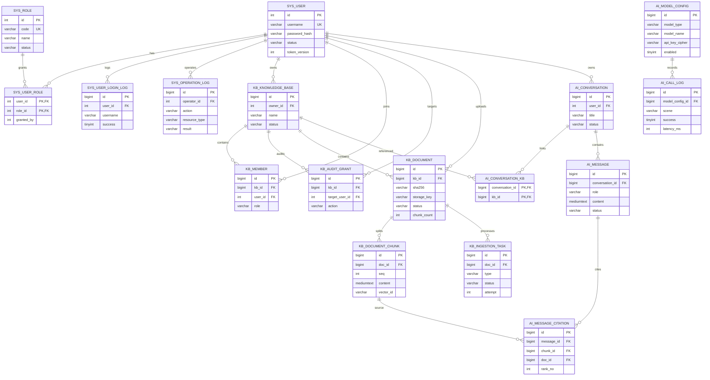

# 数据库设计

> 任务：T5.9
> 权威脚本：[V1__init.sql](../database/migrations/V1__init.sql)、[V2__stage4_observability_indexes.sql](../database/migrations/V2__stage4_observability_indexes.sql)、[R__seed.sql](../database/migrations/R__seed.sql)

## 1. ER 图



## 2. 17 张表

| # | 表 | 核心用途 |
|---:|---|---|
| 1 | `sys_role` | 系统角色 |
| 2 | `sys_user` | 账户与 token 版本 |
| 3 | `sys_user_role` | 用户角色关联 |
| 4 | `sys_user_login_log` | 登录审计与锁定证据 |
| 5 | `sys_operation_log` | 关键操作审计 |
| 6 | `kb_knowledge_base` | 知识库 |
| 7 | `kb_member` | 知识库成员权限 |
| 8 | `kb_audit_grant` | 授权变更留痕 |
| 9 | `kb_document` | 文档状态与文件元数据 |
| 10 | `kb_document_chunk` | 文本分片与向量 ID |
| 11 | `kb_ingestion_task` | 异步处理任务 |
| 12 | `ai_conversation` | 问答会话 |
| 13 | `ai_conversation_kb` | 会话关联知识库 |
| 14 | `ai_message` | 用户与助手消息 |
| 15 | `ai_message_citation` | 回答引用 |
| 16 | `ai_model_config` | 加密模型配置 |
| 17 | `ai_call_log` | 模型调用日志 |

## 3. 关键约束

### 3.1 唯一性

- 用户名 `sys_user.username` 唯一。
- 角色编码 `sys_role.code` 唯一。
- 同一用户同一知识库只有一个 `kb_member`。
- 同一知识库中同一 `dedup_key` 唯一；文档删除时置 NULL，允许重新上传。
- 同一文档内 `(doc_id, seq)` 唯一。
- 同一消息同一分片只引用一次。
- 模型 `(provider, model_name, model_type)` 唯一。

### 3.2 外键与删除

- 核心关联使用真实外键和 `ON DELETE RESTRICT`。
- 用户不物理删除，使用 `status=DISABLED`。
- 知识库默认归档；文档软删除 `ACTIVE → DELETING → DELETED`。
- 会话物理删除时由应用按 citation → message → conversation-kb → conversation 顺序清理。
- `ai_call_log.model_config_id` 使用 `ON DELETE SET NULL`，保留历史统计。

### 3.3 引用完整性

`ai_message_citation(chunk_id, doc_id)` 使用复合外键指向
`kb_document_chunk(id, doc_id)`。数据库层保证“引用里的分片确实属于该文档”，Java 仍会
重新验证当前用户权限、文档 ACTIVE 状态和分片是否属于本次检索集合。

## 4. 状态机

文档：

```text
PENDING -> PROCESSING -> ACTIVE
    ^          |
    |          v
    +-------- FAILED
ACTIVE -> DELETING -> DELETED
              |
              v
         DELETE_FAILED
```

任务：

```text
QUEUED -> RUNNING -> SUCCESS
   ^         |
   +---------+ (timeout or manual retry)
             |
             +-> FAILED -> DEAD (attempt exhausted)
```

## 5. 索引原则

- 列表页筛选与排序使用复合索引，遵守最左前缀。
- 任务扫描使用 `(status, created_at)`。
- 超时回收使用 `(status, locked_at)`。
- 登录日志使用 `(user_id, created_at)` 和 `(username, created_at)`。
- 调用统计使用 `(created_at)`、`(model_config_id, created_at)`、`(scene, created_at)`。
- 文档去重依赖 `(kb_id, dedup_key)`。
- 引用校验依赖 `uk_chunk_id_doc(id, doc_id)`。

## 6. 迁移与种子

| 文件 | 类型 | 说明 |
|---|---|---|
| `V1__init.sql` | 版本迁移 | 17 张表、索引、检查约束 |
| `V2__stage4_observability_indexes.sql` | 版本迁移 | 审计与错误统计索引 |
| `R__seed.sql` | 可重复迁移 | 三个系统角色和默认管理员 |

默认管理员仅用于本地演示：`admin / Admin@123456`。生产首次登录后必须修改密码。
开发 profile 额外加载 `R__zz_dev_test_users.sql` 测试账号。

检查迁移：

```sql
SELECT installed_rank, version, description, success, checksum
FROM flyway_schema_history
ORDER BY installed_rank;
```

不要修改已经执行过的版本迁移；修复使用新版本 SQL。
